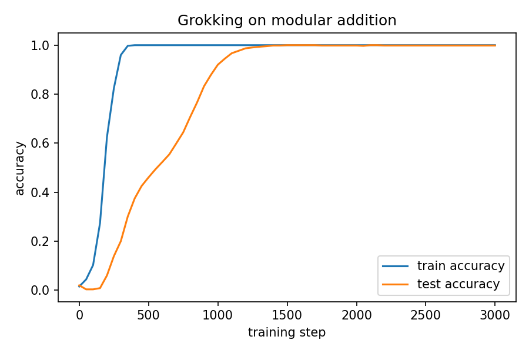
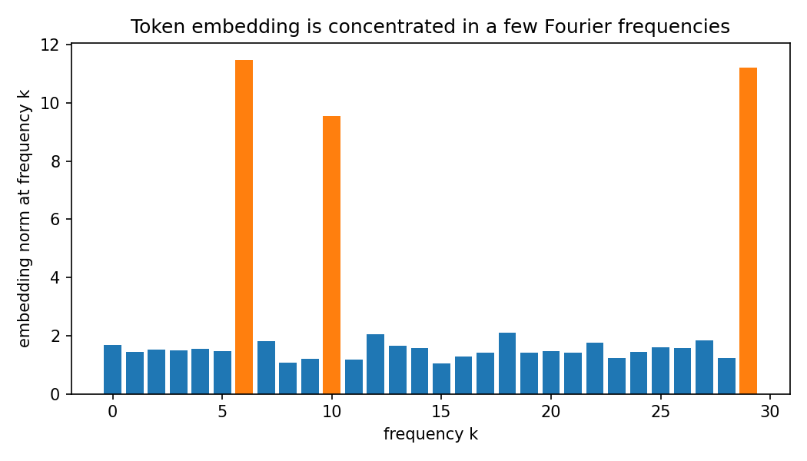
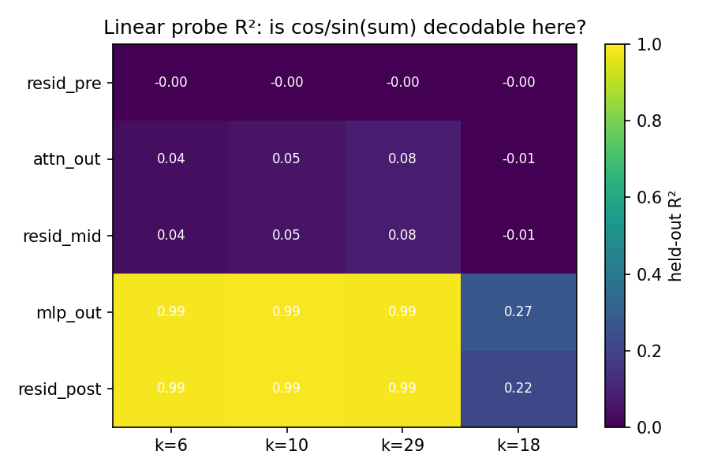
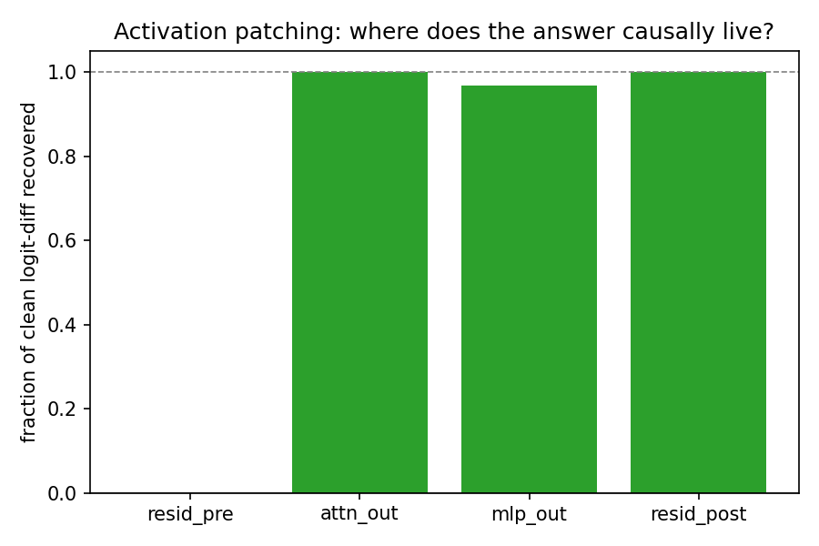

# grok-circuits

A small, from-scratch reproduction of **grokking** and the **Fourier
multiplication circuit** it produces, as described in Power et al. (2022,
["Grokking"](https://arxiv.org/abs/2201.02177)) and Nanda et al. (2023,
["Progress measures for grokking via mechanistic
interpretability"](https://arxiv.org/abs/2301.05217)). Everything here
trains on CPU in a few minutes — there's no pretrained model, no API calls,
just a one-layer transformer and closed-form analysis of what it learned.

## Task

A 1-layer, no-LayerNorm transformer (`src/model.py`) is trained on
`(a, b) -> (a + b) mod p` for `p = 59`, with only 60% of the `(a, b)` pairs
seen during training. The question driving this project: once it learns to
generalize, *how* does the network represent and compute the sum?

## 1. Grokking

With weight decay and a restricted training set, train accuracy hits 100%
almost immediately while test accuracy lags behind by several hundred
steps before catching up — the network's representations keep changing
well after it has "solved" the training set.



Run it yourself: `python -m scripts.run_training`

## 2. What did it learn? (linear probing)

Projecting the trained token embedding onto Fourier basis vectors shows
the model doesn't represent numbers in order along a line — it concentrates
nearly all its embedding norm into a handful of frequencies (here, k = 6,
10, 29 out of 30 possible):



This matters because of how trig identities work: if `a` and `b` are each
represented as `cos`/`sin` at frequency `k`, then
`cos(k(a+b)) = cos(ka)cos(kb) - sin(ka)sin(kb)` — the sum is computable
from products of the individual terms, which a one-layer attention+MLP
network can realize. To check whether the network actually uses this, I
fit a linear probe (ridge regression) at each point in the residual stream,
predicting `cos`/`sin` of the *true* sum at the key frequencies, and
report held-out R²:



The sum is **not** linearly decodable before the MLP (R² ≈ 0), partially
decodable after attention (R² ≈ 0.04–0.08), and almost perfectly decodable
after the MLP (R² ≈ 0.99) — but only at the three key frequencies. A
control frequency the embedding doesn't use (k = 18) never becomes
decodable. This localizes *where* the sum becomes a linear feature.

Run it yourself: `python -m scripts.run_probing`

## 3. Is it actually causal? (activation patching)

Probing only shows correlation. To test whether a hook point is *causally*
responsible for the answer, I run the model on a "clean" input it answers
correctly and a "corrupted" input with a different answer, then splice the
clean run's activation at one hook into the corrupted forward pass —
patching only the final ("=") token position, so the a/b tokens stay
corrupted. If that one substitution restores the clean answer, this hook
causally carries the relevant computation (logit-diff recovery, averaged
over 500 random clean/corrupt pairs):



- `resid_pre` (the "=" token's embedding before attention): **0%** recovery
  — expected, since this value is identical across every example and
  carries no information about `a` or `b`.
- `attn_out`: **100%** recovery — everything downstream is a deterministic
  function of this one vector, so it already fully determines the answer,
  even though (per the probing above) it isn't yet *linearly* decodable.
- `mlp_out`: **97%** recovery — the MLP alone accounts for nearly all of
  the computation; the ~3% gap is the residual stream's skip connection
  carrying some of the signal around the MLP.
- `resid_post`: **100%** recovery — trivially true, since this is exactly
  what gets unembedded into logits.

Run it yourself: `python -m scripts.run_patching`

## Why this task

This is a condensed version of a well-studied interpretability result,
picked because it's cheap to reproduce honestly end-to-end (training,
probing, and causal verification) rather than because it's novel. The
combination — a correlational probe followed by an interventional check
that either confirms or contradicts it — is the methodological pattern I'm
most interested in applying to less toy settings.

## Project layout

```
src/
  data.py       modular addition dataset + train/test split
  model.py      1-layer transformer with an activation cache
  train.py      full-batch AdamW training loop
  probing.py    Fourier frequency analysis + linear probes
  patching.py   activation patching / causal mediation
  plotting.py   matplotlib helpers
scripts/        thin entry points that call into src/ and save to results/
tests/          pytest unit tests for each module
results/        checkpoint, metrics, and the figures embedded above
```

## Running it

```
pip install -r requirements.txt
pytest -q                        # unit tests
python -m scripts.run_training   # ~4 min on CPU, writes results/checkpoint.pt
python -m scripts.run_probing
python -m scripts.run_patching
```
